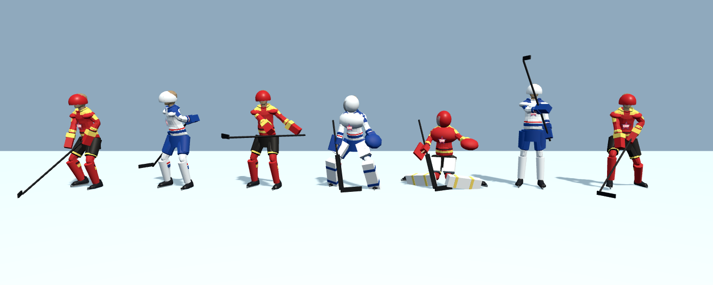

# Хоккейный ИИ на площадке (`src/game/rinkAI.ts`)

С этой версии 2D-площадка и 3D-повтор показывают не реконструкцию «от события к
событию», а **агентную симуляцию**: каждый полевой и вратарь — агент с позицией,
скоростью, ускорением и максимальной скоростью из навыков (катание, ускорение,
пас, бросок, руки, силовая борьба). Статистический движок по-прежнему главный:
броски, сейвы, голы, авторы, ассистенты, удаления и силовые случаются ровно в свою
игровую секунду; «режиссёр» направляет свободную игру так, чтобы шайбой владела
нужная команда, пасовали нужные игроки и бросал нужный игрок из записанной точки.

- **Игроки играют шайбой**: владелец решает — вести, отдать пас (оценка
  открытости и коридора), выбросить/вывести по борту, вбросить в зону, бросить
  мимо; соперники прессингуют, отбирают, перехватывают передачи, блокируют
  броски, подбирают отскоки; вратарь занимает угол и накрывает шайбу.
- **Тактика** берётся из тренерского мостика: форчек (прессинг / баланс / капкан)
  меняет высоту давления, акцент в атаке (броски от синей / комбинации / до
  верного) — расстановку в зоне. Замены на ходу, скамейка штрафников,
  большинство/меньшинство и пустые ворота.
- **Офсайда нет**: зона считается покинутой только после полного пересечения
  синей линии (30 см); партнёр не может въехать в зону раньше шайбы, владелец
  ждёт, пока партнёры выйдут («tag-up»), передачи и вбросы в зону — только когда
  все в позиции. Тест держит долю спорных входов ниже 1 %.
- **Время стоит при остановках**: свисток → сбор к точке → расстановка →
  вбрасывание. Игровые часы (`g`) замирают с момента свистка до вбрасывания;
  анимация (`tau`) при этом продолжается. На вбрасывании видны судья и центры.
- **Темп трансляции**: опасные моменты, свистки и вбрасывания идут почти в
  реальном времени, рутинное катание ускорено (`RinkAI.PACE`), поэтому период по
  длительности такой же, как раньше (≈4–5 мин на ×1).
- **Больше хоккея в матче**: выигранные вбрасывания, блок-шоты, отборы и
  перехваты, пробросы видны в хронике и в статистике матча; панели «На льду»
  следуют за реальными заменами на площадке.
- Повтор гола использует **те же кадры**, что и 2D-площадка (`goalClip`), с
  телами игроков (`bodies: true`); ТВ-камера панорамирует за шайбой и держит
  эпизод в центре кадра.
- Тренерские изменения по ходу периода (`setEvents`) сохраняют уже показанное
  движение и пересобирают только будущее.

Проверки: `npx tsx scripts/rink-ai-test.ts` (физика, часы на вбрасываниях,
броски точно в секунду события, офсайды, телепорты, детерминизм, переигровка).

# Горизонтальная ориентация телефона

Основная ориентация — телефон боком (`@custom-variant land`: landscape и высота
≤ 560 px). Шапка в одну строку, разделы — узкой прокручиваемой колонкой слева
вместо нижней панели; прокручиваются только списки. Экран матча фиксирован:
счёт и управление сверху, площадка слева, справа одна прокручиваемая колонка
(хроника / мостик и звенья / статистика). Повтор гола рендерится через портал в
`<body>`, поэтому всегда отцентрирован во viewport и целиком помещается по высоте.

# Повтор гола и площадка во время матча

## Что изменилось

Старый повтор на CSS-фигурках заменён сценой **Three.js / WebGL** с настоящей
перспективной камерой, глубиной, освещением, тенями, объёмными моделями игроков,
клюшками, щитками, рамой/сеткой ворот, бортами, стеклом и ярусами трибун.
Все модели процедурные: внешние 3D-ресурсы, CDN и сетевые текстуры не нужны.
Зависимости входят в обычную автономную сборку GitHub Pages.

- Три ракурса: ТВ, со льда, у ворот. Переключение не сбрасывает эпизод.
- Кистевой, щелчок, бросок с ходу, подставление, добивание и неудобная сторона:
  разные темп броска, траектории/высота шайбы и подход автора.
- Точка выпуска берётся из `GameEvent.x/y`, а не зафиксирована на синей линии.
  Идентичности автора, ассистентов, соперников и вратаря — из события.
- Пас приходит в положение движущегося получателя. При голе без передач шайба
  сопровождает автора; при добивании есть первая попытка и отскок от вратаря.
- Вратарь следует углу шайбы, затем смещается в сторону цели и садится в
  «бабочку», не освобождая створ произвольным отъездом. При `EN` / `goalie: null`
  вратаря нет. Направление атаки гостей зеркалится.
- Число участников берётся из `ice`; 3×3, 4×4 и неравные составы не дополняются
  искусственно до пяти полевых. Старые события без координат/ice имеют fallback.
- Пауза, перемотка, скорости ×0.25 / ×0.5 / ×0.75 / ×1 и повторный запуск.
  Надпись «ГОЛ» появляется только после пересечения линии ворот.
- Escape закрывает повтор; фокус удерживается внутри диалога и возвращается
  после закрытия. При reduced-motion эпизод изначально приостановлен.
- Если WebGL недоступен или потерян контекст, тот же эпизод с той же временной
  шкалой показывается сверху в SVG. Кнопка продолжения остаётся доступной.

В трансляции добавлена сворачиваемая компактная **2D-площадка** (до 560 px):
номера и цвета команд, полевые игроки, вратари и контрастная шайба.

### Единая временная линия 2D и 3D

`buildRinkTimeline` строит для периода одну детерминированную последовательность:
вбрасывание → плавный переход → подход к броску → бросок → продолжение →
вбрасывание (в центре после гола, в зоне после сейва и удаления). Позиции в
конце одного отрезка совпадают с началом следующего, поэтому автор броска и
шайба не перескакивают. Отрезок броска заканчивается ровно в `GameEvent.sec`.

`advanceRinkClock` переводит реальное время в игровое с учётом выбранной
скорости ×1/×2/×4: подход и вбрасывания проигрываются в реальном темпе, а
длинные паузы между событиями сжимаются в переходах 1,2–2,5 с. 3D-повтор
получает **тот же объект клипа** (`timelineGoalClip`) и не перестраивает
эпизод заново. Последовательность строится заранее, но счёт, хроника и
статистика по-прежнему раскрываются только при достижении секунды события.
При смене тактики уже сыгранные отрезки сохраняются, продолжение начинается из
текущего кадра. Вид работает на мобильном экране,
следует общим игровым часам/скорости, замораживается при паузе, перерыве,
окончании матча и открытии повтора. Площадку можно скрыть, прекратив её обновления.
Направления атаки фиксированы так же, как на существующей карте бросков.

## Граница достоверности

Это **визуальная реконструкция**, а не трекинг точных перемещений. Текущий
статистический движок хранит дискретные события, их участников, тип и точку
броска, но не непрерывные позиции всех хоккеистов и цепочки каждого владения.
Подводящие движения, пасы между указанными ассистентами, сопротивление защиты,
высота/угол попадания и перемещения между событиями реконструируются.
Неподтверждённый трекинг не выдаётся за запись; длинные пояснения из основного интерфейса убраны.

Визуализация не вызывает `Math.random`, не меняет исходные события, результат,
статистику, травмы, тактику или сохранение. Во время матча она получает только
уже раскрытую хронику: нельзя брать события/результаты целого периода из
`sim.events`, поскольку симулятор просчитывает период заранее.
При голе часы останавливаются ровно на секунде события до открытия повтора.

## Устройство

- `src/game/rinkPlayback.ts`: чистые детерминированные траектории, интерполяция,
  безопасная обработка старых событий и схематичное движение между событиями.
- `src/components/ReplayScene.tsx`: WebGL-геометрия и камеры; освобождение
  геометрий, материалов, текстур, контекста и ResizeObserver при закрытии.
- `src/components/playerModel.ts`: риговые хоккеисты в клубной форме (см. ниже).
- `src/components/GoalReplay.tsx`: единая временная шкала и доступный диалог.
- `src/components/RinkView.tsx`: SVG-площадка для трансляции и fallback повтора.
- `src/components/Match.tsx`: подключение к раскрытым событиям, составам и часам.

Анимация ограничена 30 кадрами/с; 2D-вид — 25 кадрами/с. Обновляется отдельная
компонента, не весь матч. Pixel ratio ограничен 1.7, тени — 1024×1024.
На паузе повтор не рендерится непрерывно, только при перемотке/смене камеры.

## 3D-модели хоккеистов

- База: `src/assets/hockey-player.glb` — «Ultimate Modular Men» (Casual) от
  Quaternius, **CC0 1.0** (https://quaternius.com/packs/ultimatemodularcharacters.html,
  копия из `trebeljahr/quaternius-showcase`). Убраны волосы и UV, материалы
  переименованы (`Jersey`/`Pants`/`Skate`), сжатие meshopt (EXT_meshopt_compression):
  ~170 КБ, ~6 тыс. треугольников, 49 костей.
- В `COLOR_0` заранее запечены `|x|` и `y/2` вершин в позе покоя: шейдер формы
  рисует по ним полосы на подоле и рукавах, кокетку, полосы на гамашах и шортах —
  без текстур. Цвета: дома — `primaryColor` / `secondaryColor` / `accentColor`
  клуба, гости — белая форма с отделкой основным цветом; на груди — эмблема из
  `getClubLogoSources`, на спине — фамилия и номер (canvas).
- Экипировка (шлем с визором, маска вратаря, краги, ловушка, блин, щитки, коньки,
  наплечники, шорты) — простая геометрия, прикреплённая к костям; клюшка — в
  пространстве игрока, обе руки ставятся на неё двухзвенным IK, ноги — IK на лёд
  с плоскими лезвиями.
- Позы: накат (фаза и амплитуда — по реальной скорости на той же траектории, что
  и 2D), замах → бросок → проводка у автора гола, празднование, стойка вратаря и
  «бабочка» по тому же таймингу броска. Модель грузится лениво (`import()`),
  до загрузки и при любой ошибке показываются прежние простые фигуры.


- Цена: +~0,35 МБ к `dist/index.html` (модель, GLTFLoader, meshopt-декодер),
  ~1,5 мс на позы 12 игроков за кадр, мелкие детали не участвуют в проходе теней.

## Проверки

```sh
npm ci
npx tsc --noEmit
npx tsx scripts/rink-test.ts
npm run build
```

`rink-test.ts` проверяет 16 групп, включая совпадение 2D и 3D траекторий,
непрерывность на всех стыках, масштаб скорости часов и вбрасывания, а также: детерминизм/неизменность исходных данных,
координату броска, шесть типов, встречи пасов, зеркалирование гостей,
последовательность пересечения линии, движение вратаря, пустые ворота,
численность составов, корректность всех траекторий, legacy fallback,
остановку 2D-часов и отсутствие реакции на будущие события.

Браузерный тест требует Chromium с WebGL (подходит программный SwiftShader):

```sh
npm install --no-save --package-lock=false @playwright/test
npx playwright install chromium
# В отдельном терминале:
npm run dev -- --host 0.0.0.0
# В основном терминале:
node scripts/rink-ui-test.mjs
node scripts/management-ui-test.mjs  # штаб, увольнение/и. о., роли, двусторонний контракт, вёрстка
```

Опциональны `BASE_URL` и `CHROMIUM_PATH` для уже установленного браузера.
Тест проверяет фактический WebGL-рендер, различие камер, паузу/перемотку,
момент появления гола, скорости, повторное открытие, reduced-motion,
мобильный размер, fallback без WebGL и настоящий матч с остановкой/движением
2D-площадки и скрытием/показом. Не подменяет WebGL пустым canvas-моком.
